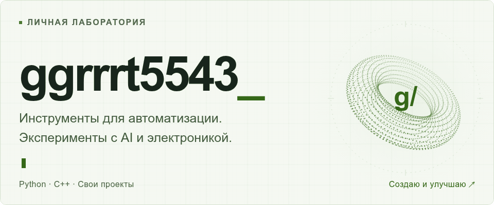
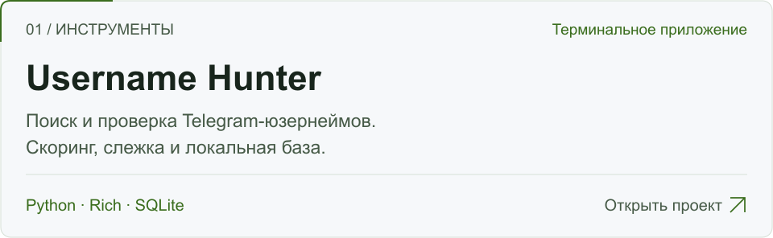
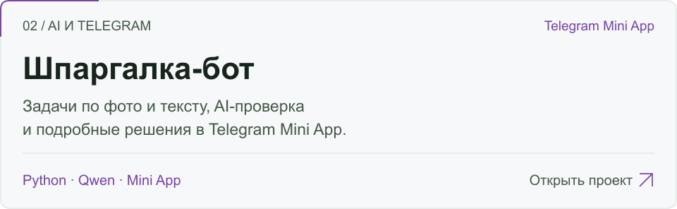
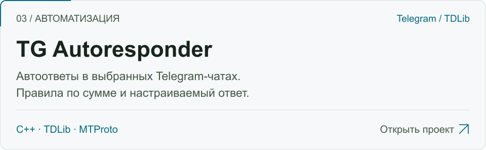
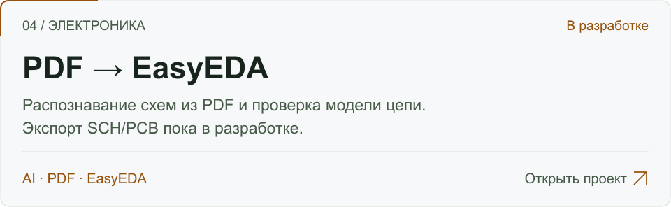

<picture>
  <source media="(prefers-reduced-motion: reduce) and (prefers-color-scheme: dark) and (max-width: 600px)" srcset="./assets/hero-dark-mobile-static.png">
  <source media="(prefers-reduced-motion: reduce) and (max-width: 600px)" srcset="./assets/hero-light-mobile-static.png">
  <source media="(prefers-reduced-motion: reduce) and (prefers-color-scheme: dark)" srcset="./assets/hero-dark-static.png">
  <source media="(prefers-reduced-motion: reduce)" srcset="./assets/hero-light-static.png">
  <source media="(prefers-color-scheme: dark) and (max-width: 600px)" srcset="./assets/hero-dark-mobile.gif">
  <source media="(max-width: 600px)" srcset="./assets/hero-light-mobile.gif">
  <source media="(prefers-color-scheme: dark)" srcset="./assets/hero-dark.gif">
  
</picture>

  <a href="#проекты">Проекты</a> &nbsp; · &nbsp;
  <a href="#технологии">Технологии</a> &nbsp; · &nbsp;
  <a href="https://ggrrrt5543.github.io/ggrrrt5543/">Портфолио ↗</a>

Пишу инструменты на **Python и C++**, автоматизирую задачи в Telegram и экспериментирую с **AI и электроникой**. Ниже — основные проекты; учебные работы собраны отдельно.

## Проекты

<a href="https://github.com/ggrrrt5543/username-hunter">
<picture>
  <source media="(prefers-color-scheme: dark) and (max-width: 600px)" srcset="./assets/showcase/hunter-dark-mobile.svg">
  <source media="(max-width: 600px)" srcset="./assets/showcase/hunter-light-mobile.svg">
  <source media="(prefers-color-scheme: dark)" srcset="./assets/showcase/hunter-dark.svg">
  
</picture>
</a>

[Скачать релиз](https://github.com/ggrrrt5543/username-hunter/releases/latest) &nbsp; · &nbsp; [Установка](https://github.com/ggrrrt5543/username-hunter/blob/main/docs/setup.md) &nbsp; · &nbsp; [Ошибки](https://github.com/ggrrrt5543/username-hunter/issues)

 

<a href="https://github.com/ggrrrt5543/shpargalka-bot">
<picture>
  <source media="(prefers-color-scheme: dark) and (max-width: 600px)" srcset="./assets/showcase/shpargalka-dark-mobile.svg">
  <source media="(max-width: 600px)" srcset="./assets/showcase/shpargalka-light-mobile.svg">
  <source media="(prefers-color-scheme: dark)" srcset="./assets/showcase/shpargalka-dark.svg">
  
</picture>
</a>

[Описание и запуск](https://github.com/ggrrrt5543/shpargalka-bot#readme) &nbsp; · &nbsp; [Исходный код](https://github.com/ggrrrt5543/shpargalka-bot)

 

<a href="https://github.com/ggrrrt5543/tg-autoresponder">
<picture>
  <source media="(prefers-color-scheme: dark) and (max-width: 600px)" srcset="./assets/showcase/autoresponder-dark-mobile.svg">
  <source media="(max-width: 600px)" srcset="./assets/showcase/autoresponder-light-mobile.svg">
  <source media="(prefers-color-scheme: dark)" srcset="./assets/showcase/autoresponder-dark.svg">
  
</picture>
</a>

[Описание и запуск](https://github.com/ggrrrt5543/tg-autoresponder#readme) &nbsp; · &nbsp; [Исходный код](https://github.com/ggrrrt5543/tg-autoresponder)

 

<a href="https://github.com/ggrrrt5543/EasyEDA-PDF-Builder">
<picture>
  <source media="(prefers-color-scheme: dark) and (max-width: 600px)" srcset="./assets/showcase/easyeda-dark-mobile.svg">
  <source media="(max-width: 600px)" srcset="./assets/showcase/easyeda-light-mobile.svg">
  <source media="(prefers-color-scheme: dark)" srcset="./assets/showcase/easyeda-dark.svg">
  
</picture>
</a>

[План разработки](https://github.com/ggrrrt5543/EasyEDA-PDF-Builder#roadmap) &nbsp; · &nbsp; [Исходный код](https://github.com/ggrrrt5543/EasyEDA-PDF-Builder)

 

## Учебные работы

<b>Arduino, базы данных и практика Git</b>

| Проект | Что внутри |
| --- | --- |
| [Шлагбаум на Arduino](https://github.com/ggrrrt5543/kursovoy15) | Виртуальная модель в Wokwi, датчики, Node-RED и журнал в SQLite. |
| [Журнал событий устройств](https://github.com/ggrrrt5543/kutuzov) | SQL-схема, тестовые данные и запросы для диагностики устройств. |
| [Практика Git](https://github.com/ggrrrt5543/git-lab) | Лабораторная работа с ветками и файлами. |

## Технологии

**Языки:** Python · C++ · SQL  
**В проектах:** Rich · TDLib · SQLite · GitHub Actions  
**Эксперименты:** Telegram Mini App · Arduino · Node-RED · EasyEDA

## Обратная связь

Нашёл ошибку или придумал улучшение? Открой issue в нужном проекте. [Все репозитории →](https://github.com/ggrrrt5543?tab=repositories)

О статусах и ограничениях

Описание возможностей взято из README проектов; это не гарантия их работы во всех средах.

Скоринг Username Hunter — эвристика, а проверка доступности не резервирует имя. Экспорт SCH/PCB в PDF → EasyEDA ещё разрабатывается. AI-решения задач и восстановленные электронные схемы требуют проверки.

Учебный шлагбаум — виртуальная модель, а не система безопасного управления реальным устройством.

