  

  <a href="#проекты">Проекты</a> &nbsp; / &nbsp;
  <a href="#технологии">Технологии</a> &nbsp; / &nbsp;
  <a href="https://github.com/ggrrrt5543?tab=repositories">Все репозитории</a>

## Привет, я ggrrrt5543

Создаю инструменты для автоматизации и экспериментирую с AI и электроникой.
Здесь — мои проекты: от терминальных утилит до работы с электронными схемами.

## Проекты

### [Username Hunter ↗](https://github.com/ggrrrt5543/username-hunter)

**Поиск Telegram-юзернеймов без хаоса в терминале.**

Генерация вариантов, проверка доступности, эвристический скоринг и слежка за выбранными именами. Rich-интерфейс, локальная база и обновления с сохранением пользовательских данных.

`Python` · `Rich TUI` · `SQLite` · `Telegram API`

[Посмотреть проект](https://github.com/ggrrrt5543/username-hunter) · [Скачать релиз](https://github.com/ggrrrt5543/username-hunter/releases/latest) · [Инструкция](https://github.com/ggrrrt5543/username-hunter/blob/main/docs/setup.md)

> Результат проверки не резервирует имя. Скоринг — эвристика, а не гарантия рыночной стоимости.

---

### [EasyEDA PDF Builder ↗](https://github.com/ggrrrt5543/EasyEDA-PDF-Builder)

**Из PDF со схемой — к структурированной модели цепи.**

Проект по восстановлению электронных схем с помощью AI: анализ PDF, структурирование компонентов и соединений, проверка данных. Цель — экспорт схем и плат в EasyEDA Standard.

`AI / Vision` · `PDF processing` · `Electronics` · `EasyEDA`

**В разработке.** Нативный экспорт SCH/PCB ещё не завершён.

[Посмотреть проект и roadmap](https://github.com/ggrrrt5543/EasyEDA-PDF-Builder#roadmap)

## Технологии

**Код** &nbsp; `Python` · `C++`  
**В проектах** &nbsp; `Rich` · `SQLite` · `GitHub Actions` · `API-интеграции`

## Обратная связь

Нашёл ошибку или придумал улучшение? Открой issue в нужном репозитории:
[Username Hunter](https://github.com/ggrrrt5543/username-hunter/issues) · [EasyEDA PDF Builder](https://github.com/ggrrrt5543/EasyEDA-PDF-Builder/issues).

---

Идея → эксперимент → рабочий инструмент.

