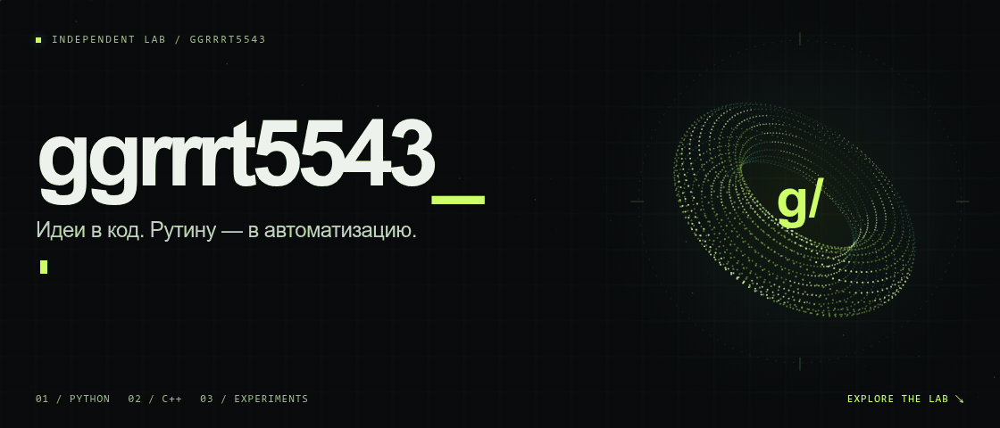
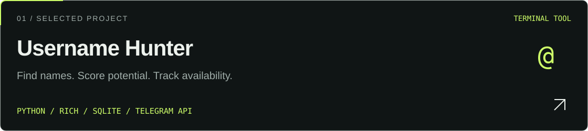
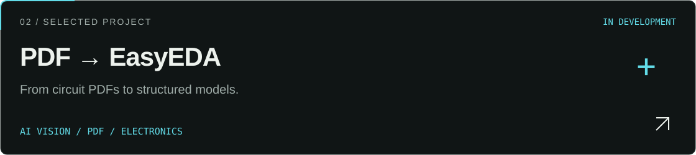

<picture>
  <source media="(prefers-reduced-motion: reduce)" srcset="./assets/hero-static.png">
  
</picture>

<p align="center">
  <a href="#selected-work">ПРОЕКТЫ</a> &nbsp; / &nbsp;
  <a href="#toolbox">ТЕХНОЛОГИИ</a> &nbsp; / &nbsp;
  <a href="https://github.com/ggrrrt5543?tab=repositories">ВСЕ РЕПОЗИТОРИИ ↗</a>
</p>

### Меньше ручной работы. Больше своих инструментов.

Создаю утилиты для автоматизации и экспериментирую с AI и электроникой.
От поиска Telegram-юзернеймов до распознавания электронных схем — превращаю идеи в код.

## Selected work

<a href="https://github.com/ggrrrt5543/username-hunter">
  
</a>

Генерация и проверка имён, эвристический скоринг, слежка и обновления с сохранением данных.

[Репозиторий ↗](https://github.com/ggrrrt5543/username-hunter) · [Скачать релиз](https://github.com/ggrrrt5543/username-hunter/releases/latest) · [Установка](https://github.com/ggrrrt5543/username-hunter/blob/main/docs/setup.md)

<a href="https://github.com/ggrrrt5543/EasyEDA-PDF-Builder">
  
</a>

AI-анализ PDF, структурированная модель цепи и проверка данных. **В разработке:** нативный экспорт SCH/PCB ещё не завершён.

[Репозиторий и roadmap ↗](https://github.com/ggrrrt5543/EasyEDA-PDF-Builder#roadmap)

## Toolbox

**Код** &nbsp; `Python` · `C++`  
**В проектах** &nbsp; `Rich TUI` · `SQLite` · `GitHub Actions` · `API-интеграции`

<details>
<summary><b>~/lab — коротко обо мне</b></summary>

```text
> cat about.txt
name      ggrrrt5543
focus     tools / automation / experiments
workflow  idea → code → test → improve
```

Скоринг Username Hunter — эвристика, а не гарантия цены. Проверка доступности не резервирует имя.
Автоматически восстановленные электронные схемы требуют инженерной проверки.

</details>

---

Есть баг или идея? Открой issue в [Username Hunter](https://github.com/ggrrrt5543/username-hunter/issues) или [EasyEDA PDF Builder](https://github.com/ggrrrt5543/EasyEDA-PDF-Builder/issues).

<p align="center"><sub>GGRRRT5543 / BUILD. TEST. ITERATE.</sub></p>
