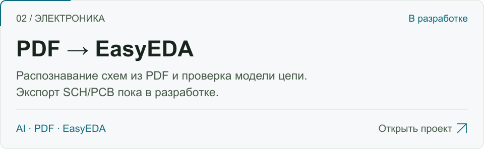

<picture>
  <source media="(prefers-reduced-motion: reduce) and (prefers-color-scheme: dark) and (max-width: 600px)" srcset="./assets/hero-dark-mobile-static.png">
  <source media="(prefers-reduced-motion: reduce) and (max-width: 600px)" srcset="./assets/hero-light-mobile-static.png">
  <source media="(prefers-reduced-motion: reduce) and (prefers-color-scheme: dark)" srcset="./assets/hero-dark-static.png">
  <source media="(prefers-reduced-motion: reduce)" srcset="./assets/hero-light-static.png">
  <source media="(prefers-color-scheme: dark) and (max-width: 600px)" srcset="./assets/hero-dark-mobile.gif">
  <source media="(max-width: 600px)" srcset="./assets/hero-light-mobile.gif">
  <source media="(prefers-color-scheme: dark)" srcset="./assets/hero-dark.gif">
  
</picture>

  <a href="#проекты">Проекты</a> &nbsp; · &nbsp;
  <a href="#технологии">Технологии</a> &nbsp; · &nbsp;
  <a href="#обратная-связь">Обратная связь</a>

Пишу утилиты на **Python**, автоматизирую повторяющиеся задачи и пробую **AI в работе с электронными схемами**. Здесь — мои проекты и эксперименты.

## Проекты

<a href="https://github.com/ggrrrt5543/username-hunter">
<picture>
  <source media="(prefers-color-scheme: dark) and (max-width: 600px)" srcset="./assets/hunter-dark-mobile.svg">
  <source media="(max-width: 600px)" srcset="./assets/hunter-light-mobile.svg">
  <source media="(prefers-color-scheme: dark)" srcset="./assets/hunter-dark.svg">
  
</picture>
</a>

[Скачать релиз](https://github.com/ggrrrt5543/username-hunter/releases/latest) &nbsp; · &nbsp; [Установка](https://github.com/ggrrrt5543/username-hunter/blob/main/docs/setup.md) &nbsp; · &nbsp; [Ошибки](https://github.com/ggrrrt5543/username-hunter/issues)

 

<a href="https://github.com/ggrrrt5543/EasyEDA-PDF-Builder">
<picture>
  <source media="(prefers-color-scheme: dark) and (max-width: 600px)" srcset="./assets/easyeda-dark-mobile.svg">
  <source media="(max-width: 600px)" srcset="./assets/easyeda-light-mobile.svg">
  <source media="(prefers-color-scheme: dark)" srcset="./assets/easyeda-dark.svg">
  
</picture>
</a>

[План разработки](https://github.com/ggrrrt5543/EasyEDA-PDF-Builder#roadmap) &nbsp; · &nbsp; [Ошибки](https://github.com/ggrrrt5543/EasyEDA-PDF-Builder/issues)

## Технологии

**Языки:** Python · C++  
**В проектах:** Rich · SQLite · GitHub Actions · API-интеграции

## Обратная связь

Нашёл ошибку или придумал улучшение? Открой issue в репозитории проекта. [Все репозитории →](https://github.com/ggrrrt5543?tab=repositories)

Ограничения проектов

Скоринг Username Hunter — эвристика, а не гарантия цены. Проверка доступности не резервирует имя.

Проект PDF → EasyEDA находится в разработке. Автоматически восстановленные схемы требуют инженерной проверки.

